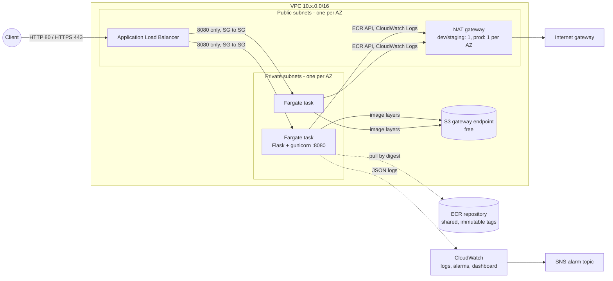
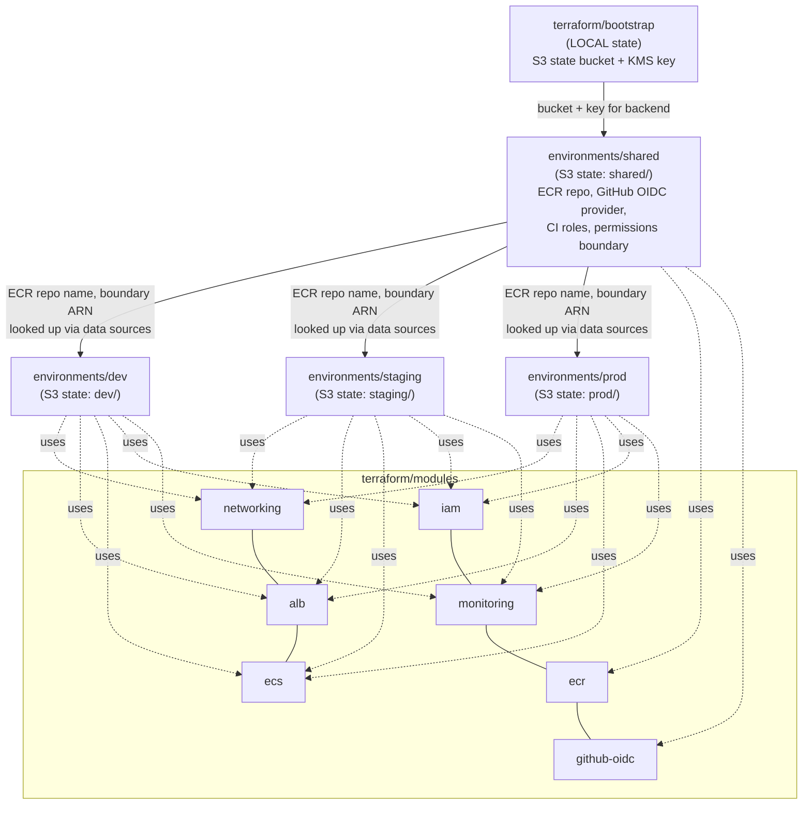
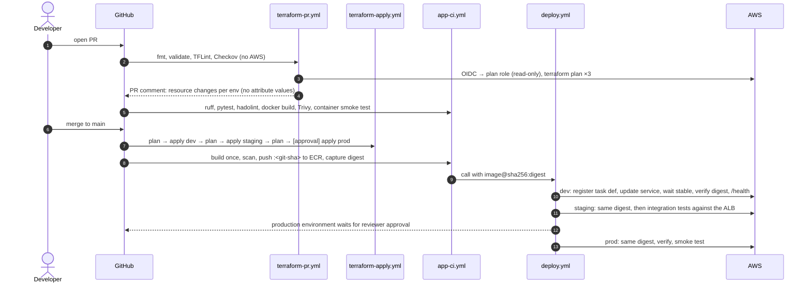

# Architecture

## Goals and constraints

* One AWS account, three isolated environments (`dev`, `staging`, `prod`) plus one
  account-wide `shared` stack. Multi-account is the recommended next step (see
  [Upgrade paths](#upgrade-paths)).
* Low cost by default. Production gets stronger availability and security settings.
* No static AWS keys anywhere: GitHub Actions authenticate through OIDC.
* The same image digest goes through dev → staging → prod. It is built once and never rebuilt.

## Runtime architecture (per environment)

* **Networking.** A `/16` VPC. Public and private subnets in `az_count` AZs (2 by default).
  The ALB is the only thing in public subnets that accepts traffic. Tasks run in
  private subnets with no public IP. An S3 *gateway* endpoint (free) carries ECR image
  layers so they skip the NAT. The default security group is locked down with no rules.
  VPC flow logs are on in prod.
* **Security groups.** `alb-sg` allows 80/443 from `allowed_ingress_cidrs`. `app-sg`
  allows only the container port, and only from `alb-sg`. The only egress is 443 to
  the internet (ECR, CloudWatch, STS through NAT). Nothing else is open.
* **Compute.** ECS on Fargate. Each task definition sets CPU and memory, a read-only root
  filesystem with an ephemeral `/tmp` volume, a non-root user, and the awslogs driver. The service
  uses the ECS deployment circuit breaker with automatic rollback, ALB health checks, and
  target-tracking autoscaling on CPU and memory.
* **IAM.** Each environment has two roles. The *task execution role* can pull from the
  shared ECR repo and write to its own log group. The *task role* is the app's identity and
  has no permissions by default. Both carry the account's workload permissions
  boundary.

## Terraform layout and dependency graph

| Root | State | Applied by | Why |
|---|---|---|---|
| `terraform/bootstrap` | **local** at first, can be migrated | admin, by hand, once | Creates the bucket that every other root stores state in. It can't depend on that bucket. |
| `environments/shared` | `s3://<bucket>/shared/terraform.tfstate` | admin, by hand | Creates the CI roles themselves. Letting CI change its own permissions would be privilege escalation. |
| `environments/{dev,staging,prod}` | `s3://<bucket>/<env>/terraform.tfstate` | GitHub Actions (`infra-<env>` environments) | Day-to-day infrastructure changes. |

Every remote state uses **native S3 locking** (`use_lockfile = true`, which writes a
`<key>.tflock` object). DynamoDB isn't needed. Environment roots never read each
other's state. They find shared resources by name with data sources
(`aws_ecr_repository`, `aws_iam_policy`), so one environment's state can't break another's.

## CI/CD flow

### OIDC role matrix

| Role | Trusted OIDC `sub` | Can do |
|---|---|---|
| `icp-gha-terraform-plan` | `pull_request`, `ref:refs/heads/main` | Read-only describe/list on platform services. Read state. Write and delete only `*.tflock` lock objects. |
| `icp-gha-terraform-apply-<env>` | `environment:infra-<env>` | Manage resources for that env. Create IAM roles only with the permissions boundary attached. Read and write only `<env>/` state. |
| `icp-gha-ecr-push` | `ref:refs/heads/main` | Push to the one ECR repo. |
| `icp-gha-deploy-<env>` | `environment:<env>` | Register task definitions, update and describe **that env's** service, and `iam:PassRole` on **that env's** task roles. |

You can also turn on a custom OIDC subject template that appends
`:ref:<git ref>` to environment subjects. IAM then rejects environment jobs from a
branch that isn't `main` or a `v*` tag. This server-side branch check works even when GitHub's
own deployment-branch rules aren't available on your plan. See [security.md](security.md).

## Key design decisions and trade-offs

| Decision | Alternative | Why |
|---|---|---|
| One shared ECR repo | Repo per env + replication | It's the only way to promote the *same digest* without copying images. |
| `ignore_changes = [task_definition]` on the ECS service | Terraform owns image updates | Deploys need to be fast and image-specific without a Terraform run. Terraform owns everything else. |
| Single NAT gateway in dev/staging, one per AZ in prod | VPC interface endpoints | Interface endpoints for ECR API, ECR DKR, and Logs across 2 AZs cost about $44/month, more than one NAT (about $33/month). In prod, a NAT per AZ removes the cross-AZ single point of failure. |
| HTTP listener by default, HTTPS when `certificate_arn` is set | Mandatory HTTPS | No domain or ACM certificate can be assumed. Prod docs require setting one before real traffic. |
| x86_64 Fargate | Graviton (ARM64, about 20% cheaper) | Standard GitHub-hosted runners for private repos are x86. Set `cpu_architecture = "ARM64"` once you build multi-arch images. |
| Trivy, TFLint, and actionlint installed from release binaries with hard-coded SHA-256 sums | Third-party wrapper actions | Fewer third-party actions in the supply chain. |

## Upgrade paths

* **Multi-account** (AWS Organizations): put each environment in its own account. The OIDC and role
  modules already take the account as an input. The state bucket can stay in a
  tooling account with cross-account bucket policies.
* **HTTPS + WAF**: set `certificate_arn` and attach `aws_wafv2_web_acl_association` to the ALB.
* **Blue/green**: switch the service to `deployment_controller { type = "CODE_DEPLOY" }`.
